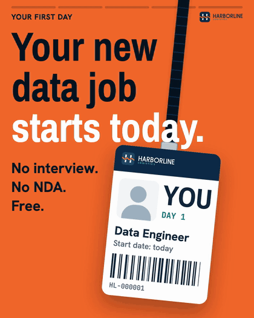
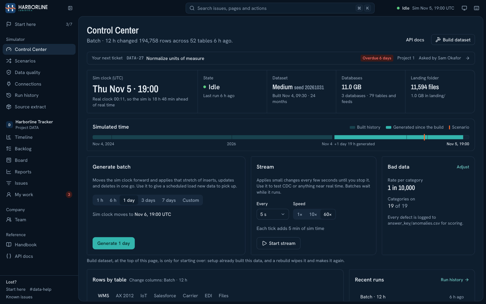
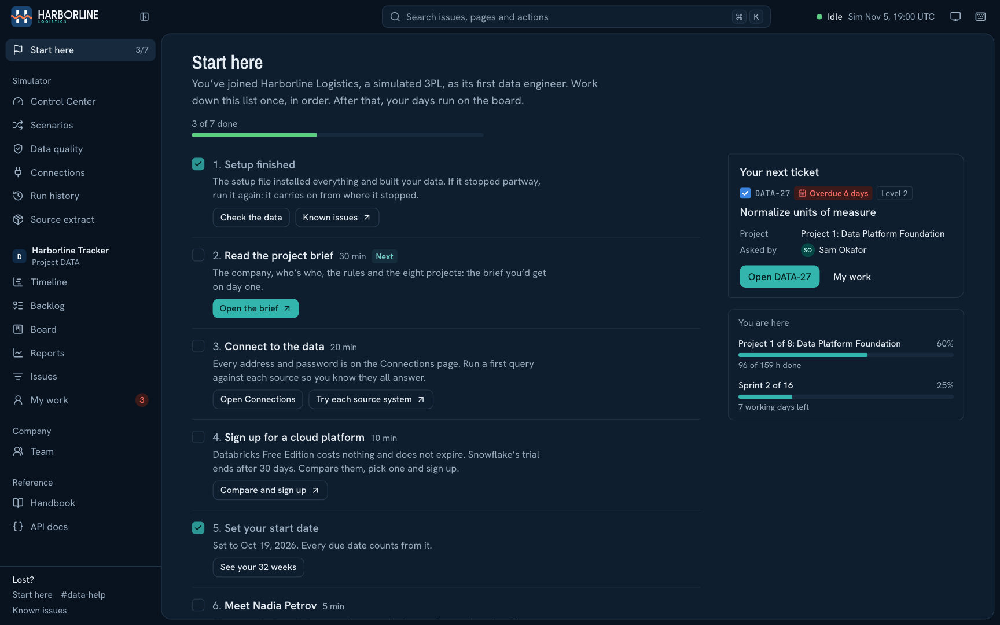
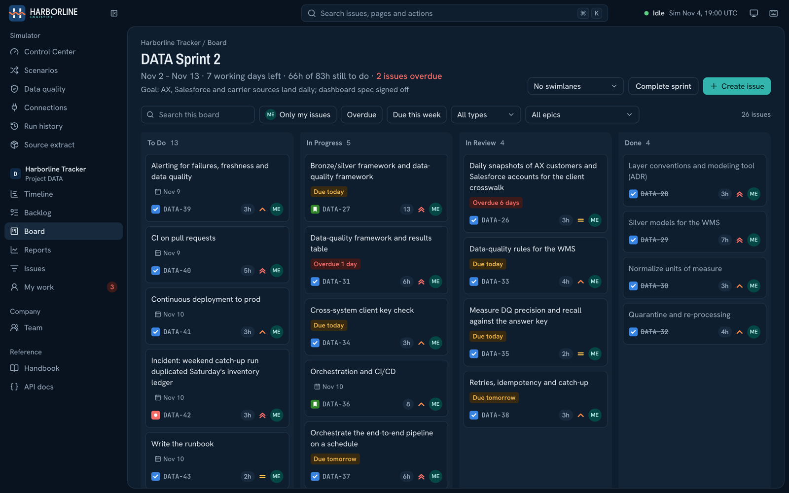
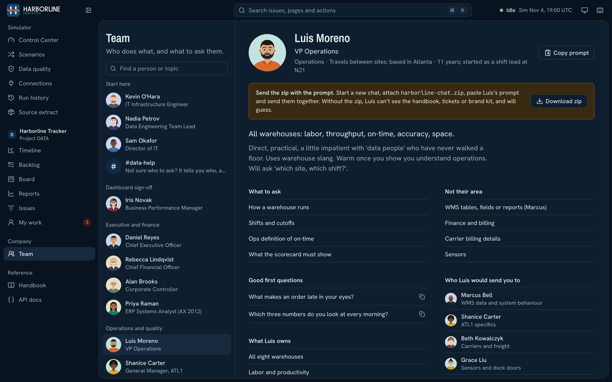
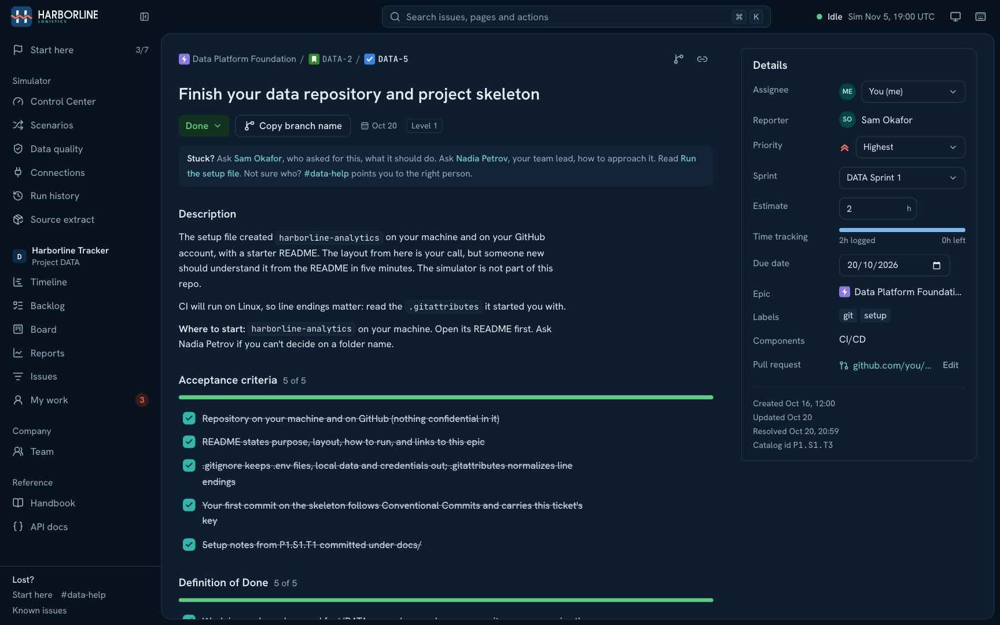
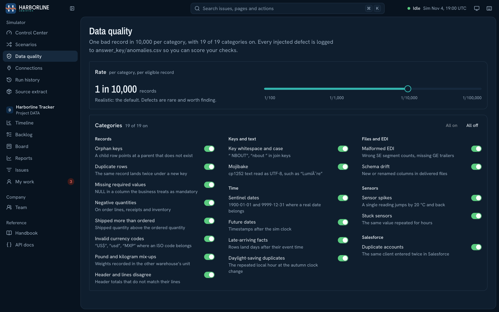
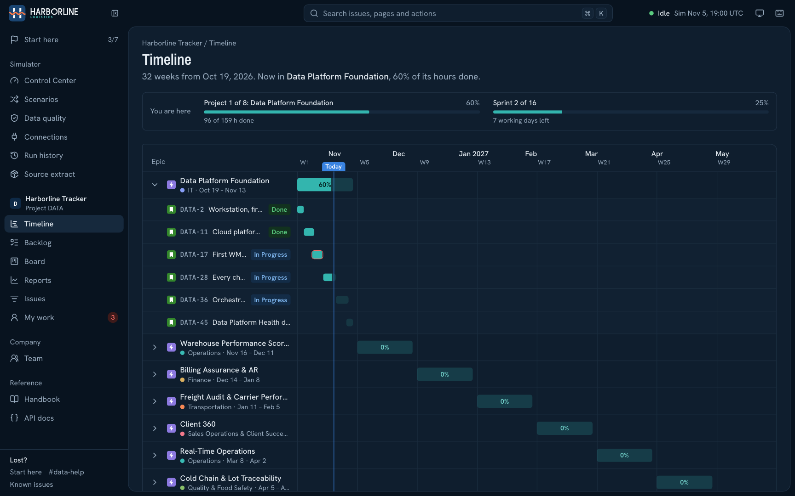
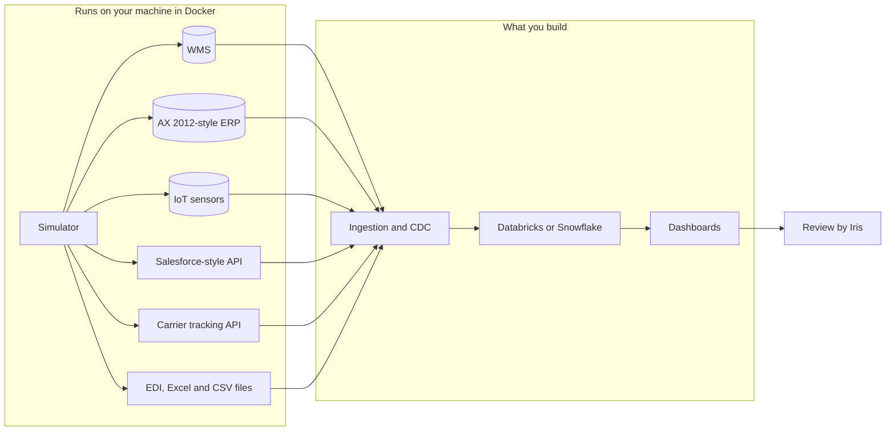

<p align="center">
  <picture>
    <source media="(prefers-color-scheme: dark)" srcset="brand/logo/harborline-lockup-dark.svg">
    
  </picture>
</p>

<h2 align="center">Do the real data engineering job before anyone hires you to do it.</h2>

<p align="center">
  Harborline Lab is a complete simulated company that runs on your machine.<br>
  Seven messy source systems, 385 tickets with due dates, and 19 AI colleagues who disagree with each other.
</p>

<p align="center">
  <a href="https://fareselsayed.github.io/harborline-lab/"><b>Try the live demo</b></a>
  &nbsp;·&nbsp;
  <a href="#quick-start"><b>Install it</b></a>
  &nbsp;·&nbsp;
  <a href="#the-8-projects">See the projects</a>
  &nbsp;·&nbsp;
  <a href="https://fareselsayed.github.io/harborline-lab/handbook/">Read the handbook</a>
</p>

<p align="center">
  <a href="LICENSE"></a>
  
  
  
</p>

<p align="center">
  <a href="https://fareselsayed.github.io/harborline-lab/"></a>
</p>

## Why this exists

Tutorials give you one clean CSV. Real jobs give you an ERP from 2012, a CRM whose IDs don't match anything, rows that get hard-deleted while you're looking at them, and three managers with three definitions of "on time".

And the best work you've done at a real job usually can't be shown to anyone, because it sits behind an NDA.

Harborline Logistics fixes both. It's a warehouse and shipping company (a 3PL) with a full simulated business behind it, and the job comes with it: a backlog, deadlines, colleagues, a dashboard review. Everything you build there is yours to show in an interview.

## What you get

| | |
|---|---|
| **A whole company** | 8 warehouses across the US, Canada and Mexico, 60 clients in 9 industries, and up to 2.3 million orders over 3 years |
| **7 source systems** | A WMS, an AX 2012-style ERP, a Salesforce-style API, a carrier tracking API, IoT sensors, EDI files, and Excel and CSV files |
| **Data that keeps changing** | Generate a day of business in one click, or stream it live. Inserts, updates and hard deletes, with logical replication on so you can build real CDC |
| **Realistic dirt** | Orphans, duplicates, late facts, schema drift and more, at a rate you control (1 bad record in 10,000 by default). Every one is logged, so you can score your own data-quality checks |
| **A real backlog** | 8 projects, 32 weeks, 385 pre-written tickets with due dates and acceptance criteria, on a Jira-style board that runs locally |
| **It starts easy and gets harder** | Tickets run from level 1 to level 5. Your first sprint is a first query, a first table and a first pull request. By the last project you're handed an ambiguous business problem and a deadline, and the method is yours |
| **You won't get lost** | A Start here page, your next ticket always in view, a "Stuck?" line on every ticket, and a board you can order by due date |
| **19 AI colleagues** | The CFO, the warehouse GM, the Salesforce admin and more, each with a prompt you paste into any AI website. They know their own area, send you to the right person, and argue about definitions |
| **A team lead and a reviewer** | Nadia coaches you without writing the solution. Iris signs off your dashboards against the source data |
| **Hidden business problems** | The data holds real stories to find. Finding them is the job |
| **A brand kit** | Logo, palettes, dashboard backgrounds and a Power BI theme, so your dashboards look professional |
| **A setup that fixes itself** | One file per operating system. It installs what's missing and handles most known errors on its own |

## See it

<p align="center">
  
</p>

<table>
  <tr>
    <td width="50%"></td>
    <td width="50%"></td>
  </tr>
  <tr>
    <td align="center">Always know what to do next</td>
    <td align="center">Your sprint board, ordered by due date if you like</td>
  </tr>
  <tr>
    <td width="50%"></td>
    <td width="50%"></td>
  </tr>
  <tr>
    <td align="center">Who does what, and what to ask them</td>
    <td align="center">Every ticket says who to ask when you're stuck</td>
  </tr>
  <tr>
    <td width="50%"></td>
    <td width="50%"></td>
  </tr>
  <tr>
    <td align="center">Choose how dirty the data gets</td>
    <td align="center">32 weeks of work, laid out</td>
  </tr>
</table>

No install needed to look around: **[open the live demo](https://fareselsayed.github.io/harborline-lab/)**. It runs in your browser with sample data.

## Quick start

### Windows

1. Click **Code → Download ZIP** on this page, and extract the zip.
2. Double-click **`SETUP-WINDOWS.cmd`**. If Windows warns about it, choose **More info → Run anyway**.
3. Answer what it asks. When it needs you to do something, it says **YOUR TURN**.

### Mac

1. Download and extract the zip the same way.
2. Right-click **`SETUP-MAC.command`** and choose **Open**.
3. Answer what it asks.

### What setup does

Every step checks first and skips anything already done. If it stops, run the same file again and it carries on.

- Installs what's missing: WSL2 and Docker Desktop, Git, GitHub CLI, VS Code, uv and Python, and DBeaver
- Signs you in to GitHub and creates **your own** `harborline-analytics` repo, with commit checks and a protected `main`
- Starts the simulator and asks how much data to build
- Connects DBeaver to the databases
- Walks you through creating your AI colleagues on any AI website: ChatGPT, Claude, Gemini, Copilot or another. Each chat starts with the colleague's prompt **and `harborline-chat.zip` in the same message**. Without the zip they can't see the company and will guess

Then open **http://localhost:8080** for the Control Center, tracker and Team page.

### Already have Docker?

Windows:

```bat
start.bat
```

Mac or Linux:

```bash
./start.sh
```

They create `.env` with passwords and keys made just for your machine, then start everything. A bare `docker compose up` stops and tells you to do this first, so nobody runs on a blank password. Open http://localhost:8080 and press **Build dataset**.

## Updating

Run the setup file again: `C:\dev\harborline-lab\SETUP-WINDOWS.cmd` on Windows, or `~/dev/harborline-lab/SETUP-MAC.command` on a Mac. It checks for a new version and asks first. Your data, settings and progress are kept, your passwords and keys stay the same, and it never starts a data build by itself.

## What it needs

- 16 GB of RAM recommended, and 4 or more CPU cores
- An SSD with room for the size you pick
- Docker Desktop (setup installs it)
- A free account on Databricks or Snowflake for what you build. Databricks Free Edition is the free path; Snowflake's trial ends after 30 days

You pick the size during setup:

| Size | History | Disk | Time on a 6-core laptop (estimate) | Time on a fast Mac (measured) |
|---|---|---|---|---|
| Small | 6 months | about 3 GB | about 10 minutes | about 1 minute |
| **Medium** (default, has all 8 warehouses) | 24 months | about 12 GB | about 1 hour | 10 minutes |
| Large | 36 months | about 30 GB | about 3 hours | 21 minutes |

Every ticket works on any size. Medium is 980,000 orders, 3.9 million order lines and 9.6 million ledger rows. Large is 2.37 million orders, 9.6 million order lines and 23 million ledger rows.

## The 8 projects

Each project runs about 4 weeks at 40 hours a week and ends in dashboards, a sign-off from Iris and a short readout to whoever asked for it.

| Weeks | Project | Who asks for it |
|---|---|---|
| 1–4 | **Data Platform Foundation** | Director of IT |
| 5–8 | **Warehouse Performance Scorecard** | VP Operations |
| 9–12 | **Billing Assurance and AR** | CFO |
| 13–16 | **Freight Audit and Carrier Performance** | Transportation Manager |
| 17–20 | **Client 360**, including reverse ETL back to the CRM | Director of Sales Ops |
| 21–24 | **Real-Time Operations** with CDC, at most 5 minutes behind | VP Operations |
| 25–28 | **Cold Chain and Lot Traceability** | Quality Manager |
| 29–32 | **Client Portal and Executive Scorecard**, with row-level security | CEO |

Git practice is part of the work: a branch per ticket, pull requests, CI, and a release per project. You can also export the tickets to a free Jira Cloud site.

## How it fits together



Nothing is pushed to the cloud for you. Getting the data there is your job.

## Spoilers

[`answer_key/`](answer_key/) and `handbook/answer-key.html` say exactly what's hidden in the data and where. It's there so you can check your work after a project. It runs on the honour system, so don't open it first. Your AI colleagues can't see it.

## Questions

**Is the data real?** No. Everything is generated. The companies, people and transactions are all fictional, though the structures follow how these systems really work.

**Is it free?** Yes, and it's open source. The cloud platform and AI website you pick have their own free tiers and limits.

**Do I need an AI subscription?** No. A free account on any AI website is enough for the colleagues, though limits vary by site.

**Can I show my work to employers?** Yes, that's the point. Put your own repo and dashboards on your profile.

**Something broke during setup.** Run the file again first. Then check the [known issues page](https://fareselsayed.github.io/harborline-lab/handbook/known-issues.html), and if it's still stuck, [open a setup issue](../../issues/new?template=setup-failed.yml).

## Known limits

This is a young project, and it's better that you hear this now:

- Setup has run end to end on one real Windows PC and on Mac. It will meet problems nobody has seen yet, so please report them.
- The guided AI chat step hasn't been fully tried on every AI site.
- Build times on your machine may differ a lot from the figures above.

## Contributing

Setup reports, new scenarios, tickets and dashboard examples are all welcome. See [CONTRIBUTING.md](CONTRIBUTING.md).

## Credits

Maintained by [Karim Mohamed Abdelaziz](https://github.com/KarimAbdelaziz2503). Built with a lot of help from AI coding tools, and hardened on a real Windows PC.

Harborline Logistics, its people and its clients are fictional. Product names such as Salesforce, Jira, Dynamics AX, Databricks and Snowflake, and the carrier names in the simulated data, belong to their owners. They are used only to describe what is being simulated, and this project isn't affiliated with any of them.

Released under the [MIT licence](LICENSE).
